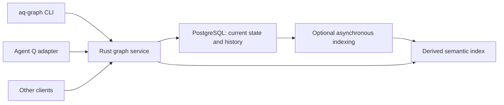

# aq-graph service and CLI

**Status:** Draft specification

**Scope:** Standalone task and knowledge graph, selective history, and concurrent access

aq-graph provides a shared task and knowledge graph through a persistent service and a command-line client. Agent Q is one consumer; other tools and people can use aq-graph without installing Agent Q.

The design prioritizes fast answers under mixed traffic from dozens to hundreds of agents. Rust implements the service and CLI. PostgreSQL holds current state and selected history. Each workspace has one authoritative store. Offline database merging and full database branching are deferred.

This is a separate component specification. It does not expand Agent Q's initial infrastructure phase to include task execution or knowledge management.

**Fresh-start boundary:** Agent Q v2 starts with new data and a new contract. V1 behavior is a design and regression reference, not a full compatibility requirement. aq-graph will not include a v1 importer, legacy-history ingestion API, legacy database adapter, or supported migration workflow for other installations. Any later owner-specific transfer is a separately maintained external script, not a requirement for launching v2. Internal aq-graph schema upgrades and backup/restore remain supported operational responsibilities.

## Decisions and repository boundary

The project and executable are named `aq-graph`. Develop them in their own repository with independent versions, CI, artifacts, and releases.

| aq-graph owns | Agent Q owns |
| --- | --- |
| Task and knowledge schemas, typed relationships, intrinsic graph readiness | Scheduling, dispatch, routing, provider selection, and resource availability |
| Current records, revisions, lifecycle events, change sets | Worker leases, execution attempts, heartbeats, and execution logs |
| Service, CLI, API contract, storage migrations | Adapter to the graph API and mapping of AQ identities and policies |
| Search, bounded traversal, context retrieval | Agent prompts, harnesses, playbooks, reviews, and integration trains |
| Standalone Compose setup and component release artifacts | Combined deployment, outer login integration, and coordinated upgrades |

aq-graph must not import Agent Q code or read its database tables. Agent Q must not bypass the graph API to mutate aq-graph tables. Integration tests should exercise the published contract, rather than requiring matching source checkouts.

The initial architecture uses a single service instance and a PostgreSQL instance on a private network. The service may process concurrent requests, with a bounded connection pool. A development stack may run entirely on a laptop. Standalone means independent of AQ; it does not imply an embedded database or installation without PostgreSQL.

## User workflows and scope

The first useful release supports creating tasks and knowledge, connecting them, retrieving actionable context, searching knowledge, inspecting history, and applying validated batches of changes.

Examples of questions it must answer efficiently include:

- What is this task, what blocks it, and which knowledge records are relevant?
- Which active tasks have their graph prerequisites satisfied?
- What directly depends on this task, and what is affected within a specified depth?
- Which decisions mention authentication, and what sources support them?
- What changed in this record, who changed it, and which related edits were applied together?

Retrieving evidence must not require a model call. Natural-language synthesis, embedding providers, and semantic reranking are optional later integrations with separate latency budgets.

The first release excludes agent execution, distributed execution claims, offline replicas that merge, arbitrary historical reconstruction of the complete graph, a custom database engine, and a graphical editor. It also excludes enterprise multi-tenant administration. Workspace scoping and authorization are still required from the start.

## Architecture



Use a Rust workspace with distinct domain, PostgreSQL storage, service, and CLI modules or crates. Select framework and database-driver versions during the initial prototype. Tokio is a candidate runtime for asynchronous I/O; CPU-heavy work must have separate bounded execution capacity rather than monopolizing request workers. [Tokio tutorial](https://tokio.rs/tokio/tutorial)

The CLI is a thin client. All authoritative reads and writes pass through service operations so that authorization, concurrency rules, and history behave consistently. A standalone local setup starts the same service against local PostgreSQL, with a loopback endpoint and local credentials.

Use a versioned HTTP API with structured JSON initially. Reuse connections and provide batch and context endpoints to avoid repeated network round trips. Native client libraries and additional transports can follow evidence of need.

## Domain model

### Records and relationships

Give every record a stable opaque identity, a workspace, a kind, a current version token, and creation metadata. The implementation already uses one `nodes` table and one Rust `Node` type, with kind-specific field validation. Keep queryable structure typed rather than encoding all useful fields as unrestricted JSON. Namespaced extension metadata may use JSON where it does not obscure common query paths.

**Proposed simplification, not yet a runtime schema change:** use a common field contract for task and knowledge content, provenance, revision-bound summaries, validity windows, review dates, and replacement relationships. Optional fields belong to the common node structure when their meaning applies to either kind. Keep execution state and acceptance criteria as task-specific planning properties, and distinguish execution completion from evidence verification. A validity window is not a task deadline. Archival/retirement, verification, and execution should remain separate concepts even in one structure. This direction requires a follow-up field/validation design; it does not imply that the current API already accepts knowledge-only fields on tasks.

Tasks contain durable planning content such as title, description, acceptance criteria, labels, and lifecycle state. Proposed minimum lifecycle states are draft, active, completed, and canceled. Graph readiness is derived separately. Reopening a task is a lifecycle transition, not deletion of its completion history.

Knowledge records contain content, content type, provenance, lifecycle state, and verification state. Preserve the existing concepts of facts, decisions, policies, procedures, incidents, references, and notes. Retired knowledge remains distinct from deleted knowledge. Verification status records an assertion by an actor; it is not proof that the content is true.

Model relationships as first-class records with stable IDs, typed endpoints, workspace scope, and optional pinned revision references. A pinned reference must resolve to the requested revision or report that it is unavailable; it must not silently fall back to the current version.

Keep two relationship families explicit:

| Family | Initial behavior |
| --- | --- |
| Execution dependencies | `blocks` affects intrinsic readiness; directed dependency cycles are invalid. |
| Structure | `parent-child` organizes tasks and has its own acyclicity rule; parenthood alone does not block execution. |
| Informational | `references`, `motivated_by`, `produces`, `supports`, `contradicts`, and `supersedes` support retrieval without affecting readiness. |

Define edge direction in the API: `A blocks B` means B depends on A. Richer dependency types, including waits and conditional blockers, require explicit v2 semantics before adoption. Unsupported types must be rejected rather than silently reinterpreted; v1 edge types do not create a compatibility obligation.

### Readiness and context

An intrinsically ready task is active and has all blocking prerequisites completed. A canceled prerequisite remains unresolved unless an explicit graph edit removes or replaces the dependency. AQ applies routing, worker availability, policy gates, and integration rules after graph readiness. A ready result is not an execution claim.

Readiness and direct dependency answers must reflect committed authoritative state. Use indexed queries initially; introduce maintained counters or projections only with transactional correctness and repair procedures. Concurrent dependency additions must not escape validation and introduce cycles. Serializable transactions with bounded retries are one candidate; the prototype must establish a correct strategy and measure contention.

Context retrieval returns a task, a bounded dependency neighborhood, and selected linked knowledge in one response. It must disclose truncation and permit callers to set depth, record count, and response-size limits within server caps. Authorize all included records and relationships. Do not fetch an entire workspace and filter it in the client.

## Selective history

History is a schema-level policy for each data category. Ordinary writers cannot opt out of required history on individual requests.

| Data | Policy |
| --- | --- |
| Task title, description, acceptance criteria, meaningful planning metadata | Immutable full-content revisions |
| Knowledge content, provenance, verification, retirement | Immutable full-content revisions |
| Dependencies and informational relationships | Immutable addition, modification, and removal records |
| Task activation, completion, reopening, cancellation | Append lifecycle events |
| AQ execution assignments and attempt transitions | AQ-owned; optional immutable external event references in graph records |
| Worker heartbeats, lease refreshes, connection state | Outside aq-graph history |
| Readiness projections, search indexes, embeddings | Rebuildable data with source-version information |
| Request logs and diagnostics | Separate bounded operational retention |

Use separate current-state and historical storage. Conceptual tables include `nodes`, typed record content, `edges`, `node_revisions`, `edge_changes`, `events`, `change_sets`, and idempotency receipts. These names describe responsibilities; detailed DDL belongs to implementation review.

Durable content revisions store full snapshots of the versioned fields. Lifecycle events record transitions without copying unchanged descriptions. A current record's version token changes for every authoritative mutation, including lifecycle changes, so optimistic concurrency checks cover the whole record. Historical content revision identifiers are distinct from this token.

The initial creation is recorded. No-op edits do not create duplicate revisions. A command that changes both durable content and lifecycle records both within one transaction. Reverting content creates a new revision based on an earlier one; it never erases intervening history or implicitly reverses lifecycle transitions and external actions.

Each historical entry includes its stable record ID, revision or event ID, authenticated actor, server timestamp, operation type, and change-set ID. Where available, include a reason and source reference. Treat client-supplied timestamps and claimed agent identities as attributed metadata, not authenticated facts.

Deletion initially creates a tombstone and retains history and identity. Active references and dependencies must be explicitly resolved or rejected according to the operation's validation rules. Permanent erasure needs a separate administrative policy covering backups, derived indexes, and broken historical references. Credentials and secret material must not enter versioned content.

Keep durable history indefinitely by default during the initial pilot, while measuring its growth. Bound operational logs and idempotency-receipt retention separately. Large artifacts belong in external artifact storage with stable references and integrity metadata. Introduce history pruning only through an explicit policy that describes its effect on pinned revisions and restoration.

Individual record history and atomic change-set history are required. Whole-graph time travel is not promised: timestamps and monotonically allocated IDs alone do not establish transaction commit order or a consistent historical graph snapshot.

## Mutation and concurrency contract

Every mutation executes as a short database transaction. It validates authority and workspace scope, checks expected versions, applies changes to current state, appends required history, and writes any durable notification record before commit. A success response means all required state is committed. Rollback leaves neither a partial mutation nor an orphan history entry.

Concurrent independent record edits should proceed without a workspace-wide lock. Same-record edits use expected-version checks and return a structured conflict rather than overwriting another writer. Structural graph operations may need stronger isolation; correctness takes precedence over avoiding retries.

Mutations support idempotency keys scoped to actor, workspace, and operation. A repeated key with the same payload returns the committed outcome within the documented retention window. Reuse with a different payload is an error. If the connection is lost after commit, clients can safely retrieve or retry the operation within that window.

Use bounded connection pools, request queues, transaction deadlines, response limits, and retry budgets. Saturation returns an actionable overload response and retry guidance. Do not open one PostgreSQL connection for every agent or retry indefinitely during contention.

If asynchronous notifications or indexing are introduced, publish through a transactional outbox. Consumers handle at-least-once delivery idempotently. Cursor and acknowledgement semantics must avoid missing late-committing transactions; simply polling for sequence numbers greater than the last seen ID is insufficient. Querying current records remains independent of subscriber availability.

## Draft change sets

Support named drafts containing proposed node and edge edits, base-version references, an author, and an optional explanation. Draft changes remain outside the live graph and cannot activate executable work.

Clients can inspect a diff, validate the proposed result, and apply the complete bounded change set atomically. Application rechecks authorization, expected versions, references, and graph invariants against the current database. Validation performed earlier is not permission to skip checks at commit.

Reject stale conflicting proposals with enough information to revise them. Do not silently merge semantic changes. Large data loads must respect the ordinary bounded mutation contract. A dedicated bulk-ingestion feature would need a separate justified design; no legacy importer or staging workflow is promised.

Drafts provide reviewable batches, not full database branches. The initial performance prototype can use direct atomic batches; named persistent drafts follow after the mutation contract is proven.

## Search and query performance

Start with indexed identifiers, workspace and lifecycle filters, adjacency queries, and PostgreSQL full-text search. Common access paths need indexes that begin with appropriate scope and filter columns; index selection must follow measured query plans and data distribution.

Read current records directly rather than replaying history. Fetch bounded neighborhoods using database-side queries or batched access, avoiding one SQL query per edge. Deep or broad analysis has explicit limits and separate capacity from interactive requests.

Semantic search is optional later work. An asynchronous index tracks record and content revisions, embedding model version, and deletion state. Its lag must be observable. Search candidates must pass current authorization and deletion checks before being returned; index staleness must never leak removed or inaccessible content. External embedding generation and model reasoning are excluded from core query latency targets.

Caches are optional optimizations. Cache keys include authorization scope and relevant versions. Task readiness, mutation validation, and current-state reads requiring consistency must not depend on stale replicas or eventually updated caches.

## Performance acceptance

The following are proposed initial acceptance targets, to be validated on a declared reference machine. They are not claims about current implementation or guaranteed capacity on the cheapest VPS.

| Operation | Service p95 target |
| --- | --- |
| Get a record or immediate links, within documented limits | Under 25 ms |
| Ready-task query or bounded context bundle | Under 100 ms |
| Small mutation including durable history | Under 100 ms |
| Indexed full-text knowledge search | Under 200 ms |

Measure service latency from request acceptance through response completion, including service queueing, pool waits, database work, and serialization. Measure client-observed latency separately, including CLI startup, network, TLS, and the deployed Cloudflare path. Report p50, p95, p99, errors, timeouts, and throughput; successful-request latency alone cannot demonstrate acceptable behavior.

The initial benchmark proposal uses 100,000 nodes and 500,000 edges with varied degree, realistic content sizes, and at least ten historical revisions on a representative subset. Include smaller development fixtures and a larger growth scenario. State exact distributions and output limits in the benchmark report.

Exercise 50, 100, and 200 simulated clients with a proposed 80 percent read and 20 percent write mix. Include independent edits, hot-record contention, traversal, history queries, same-key retries, and competing dependency additions. Use both fixed-concurrency tests and an open-loop arrival schedule to expose queue buildup. Provisional sustained load is 200 requests per second, followed by a five-times arrival burst for ten seconds; report whether the service meets the latency targets, rejects excess load predictably, and recovers without unbounded queues. These workload numbers are tunable design inputs, not inferred from agent count alone.

Record CPU, memory, storage latency, pool waits, database lock waits, query plans, disk growth, and history write amplification. Run optimized Rust builds with production-equivalent durability and history enabled. Separate cold-start, warm steady-state, background maintenance, and restart results. Select reference hardware and establish a p99 acceptance budget from the prototype before calling the service production-ready.

## CLI and API contract

Proposed command surface:

```text
aq-graph init
aq-graph serve
aq-graph task create --title "Implement login"
aq-graph task show TASK_ID --context
aq-graph task ready
aq-graph knowledge create --file decision.md
aq-graph search "authentication decisions"
aq-graph link add TASK_A TASK_B --type blocks
aq-graph history RECORD_ID
aq-graph diff RECORD_ID --from REVISION_A --to REVISION_B
aq-graph changeset create --file proposal.json
aq-graph changeset validate CHANGESET_ID
aq-graph changeset apply CHANGESET_ID
```

These commands illustrate the contract rather than final argument spelling. `init` creates local configuration and workspace setup against a configured service or documents how to start the local stack. It must not silently create a second authoritative copy of a hosted workspace. `serve` requires configured PostgreSQL access.

All commands support machine-readable JSON and stable exit/error categories. Service configuration identifies endpoint, workspace, and credential source without requiring secret values in command arguments. Bulk operations accept structured input. Responses include version tokens, pagination or truncation metadata, and relevant operation IDs. API version negotiation and a published schema enable clients in languages other than Rust.

## Authentication and deployment

The service authenticates principals and enforces workspace-scoped read, write, and administrative capabilities. Do not accept a caller's claimed user or agent ID as authority. Agent Q can use a scoped service identity; any delegated identity mechanism must be explicitly authenticated. Cloudflare-specific validation belongs in an identity adapter, not domain code.

Local development binds to loopback or an isolated Compose network and still uses explicit local credentials. Production exposes neither PostgreSQL nor an unauthenticated graph API publicly. Agent Q can reach the service over the private deployment network. Remote direct CLI access, if enabled, uses an authenticated HTTPS route compatible with machine clients.

Publish a versioned service image and CLI artifacts. Own schema migrations in aq-graph and declare supported schema and API versions in releases. Agent Q pins a compatible release and coordinates installation through its foundation deployment mechanism. The graph process must not independently replace itself during an AQ-coordinated update.

Drain requests on shutdown, preserve committed state, and make retries safe after restart. Use readiness checks for database and migration compatibility, bounded logs, off-host backups, and restore verification. Image rollback must never point an old binary at an incompatible migrated schema; incompatible upgrades require a tested migration and recovery plan. PostgreSQL major upgrades are a separate operational procedure.

## Rust and PostgreSQL rationale

Rust is selected for a small independent component with CPU-sensitive validation, efficient request processing, and a compiled CLI. It provides native execution without a garbage collector; measured benefit still depends on how much request time is spent in application code. It cannot remove database lock waits, poor query plans, or network latency. [Rust language](https://rust-lang.org/)

PostgreSQL is the initial storage engine because concurrent clients, transactional history, and mature query tooling fit this shared-service design. Its multiversion concurrency model generally allows ordinary reads and writes to proceed without blocking each other; conflicting writes and explicit locks still require care. [PostgreSQL concurrency](https://www.postgresql.org/docs/current/mvcc-intro.html)

The existing AQ already uses PostgreSQL. Extraction and a language change must therefore be judged by measured query behavior and service isolation, rather than attributing existing slowness to a database choice without evidence.

Beads demonstrates the value of a standalone CLI and versioned task data. Dolt adds database branches, historical snapshots, and push/pull synchronization, including a separate `refs/dolt/data` Git ref in Beads. Those workflows exceed the selected single-authority scope. [Beads synchronization](https://github.com/gastownhall/beads/blob/main/docs/core-concepts/sync-concepts.md)

Dolt's documentation currently identifies serialized writes as a concurrency limitation. SQLite WAL also permits only one writer at a time. Neither is rejected as universally slow; PostgreSQL is the initial baseline for this workload, with explicit revisions replacing the subset of versioning we need. [Dolt concurrency guidance](https://www.dolthub.com/docs/sql-reference/server/troubleshooting/), [SQLite WAL](https://sqlite.org/wal.html)

Full offline merging, if required later, is a new architecture decision. SQL-level merges alone would not enforce graph acyclicity or reconcile external execution side effects.

## Implementation and integration sequence

1. **Contract and performance prototype:** establish the Rust workspace, local PostgreSQL stack, minimum schema, actor scopes, and four operations: context retrieval, ready queries, version-checked mutation with history, and dependency insertion with cycle protection. Run concurrency and correctness benchmarks before expanding the feature set.
2. **Standalone baseline:** complete node commands, relationship operations, full-text search, history and diff, bounded atomic batches, local setup, internal schema upgrades, and release artifacts. Validate restart, idempotency, authorization, and restoration.
3. **Draft proposals:** add persistent draft change sets, diff/validation/application, and explicit conflict responses. Add asynchronous consumers only when required by an actual integration.
4. **Fresh AQ v2 integration:** implement an AQ-side adapter and begin with a new workspace. Validate the selected v2 workflows and operational requirements. No legacy import or v1 feature-parity gate is required.

Keep the existing v1 installation unchanged. If its owner later chooses to transfer selected data, that work belongs to an external one-off script outside this repository. Such a script must use the supported graph contract and accurately distinguish newly created records from retained historical evidence; this does not justify adding v1-specific code or history-injection endpoints to aq-graph.

## Completion criteria and remaining decisions

The standalone baseline is usable when it operates without AQ, exposes the documented CLI and API, keeps current state and history atomic, preserves graph invariants under concurrent edits, rejects unauthorized access, and survives restart and backup restoration. It must publish reproducible performance results against the agreed hardware and workload, including p99 and overload behavior.

Before implementation expands beyond the prototype, settle the reference hardware, final workload and response-size limits, p99 budget, minimal lifecycle and edge semantics, and supported CLI operating systems. Select Rust libraries, artifact hosting, and identity integration during implementation. Semantic search, full database branching, offline synchronization, and whole-graph historical snapshots remain deferred requirements rather than implicit commitments.
